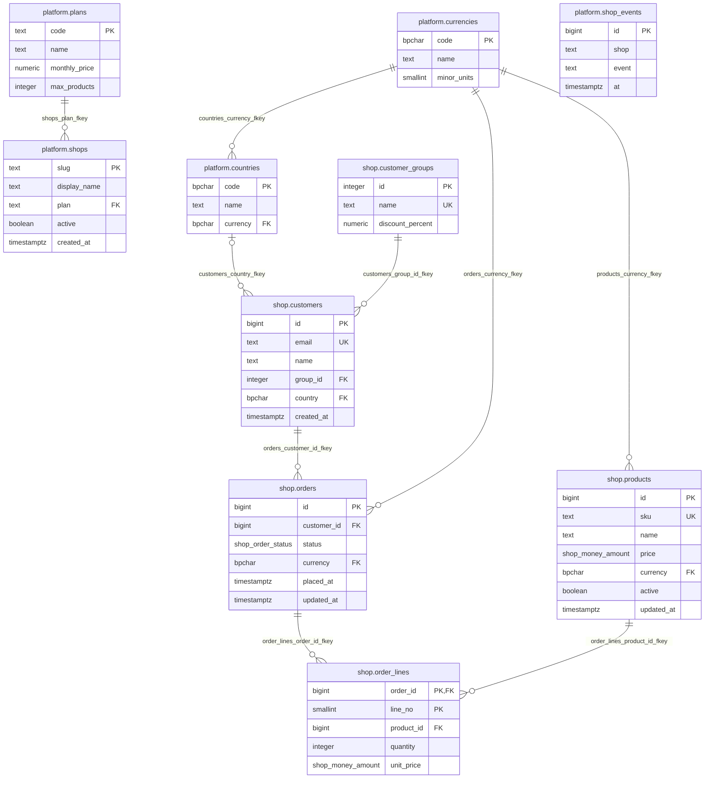

<!-- Generated by pgproj document on 2026-10-22 12:47:16 UTC -->
# Database documentation: storefront

Generated 2026-10-22 12:47:16 UTC from the project `storefront` by `pgproj document`.

## Contents

- [Summary](#summary)
- [Entity relationship diagram](#entity-relationship-diagram)
- [Schema platform](#schema-platform)
  - Tables: [countries](#platform.countries), [currencies](#platform.currencies), [plans](#platform.plans), [shops](#platform.shops), [shop_events](#platform.shop_events)
  - Functions and procedures: [format_money](#platform.format_money-numeric-bpchar-)
- [Schema shop](#schema-shop)
  - Tables: [customers](#shop.customers), [customer_groups](#shop.customer_groups), [orders](#shop.orders), [order_lines](#shop.order_lines), [products](#shop.products)
  - Views: [order_totals](#shop.order_totals)
  - Functions and procedures: [open_order_count](#shop.open_order_count-bigint-), [touch_updated_at](#shop.touch_updated_at-)
  - Types: [money_amount](#shop.money_amount), [order_status](#shop.order_status)

## Summary

| | |
|---|---|
| Schemas | 2 |
| Tables | 10 |
| Columns | 46 |
| Views | 1 |
| Functions and procedures | 3 |
| Types | 2 |
| Sequences | 0 |
| Indexes | 5 |
| Constraints | 27 |
| Triggers | 2 |
| Policies | 0 |
| Documentation errors | 0 |
| Documentation warnings | 0 |

## Entity relationship diagram



<a id="platform"></a>
## Schema platform

What every shop shares: currencies, countries, plans, and the list of shops.

### Tables

<a id="platform.countries"></a>
#### platform.countries

*table*

ISO 3166 countries a shop can ship to, with the currency used there.

| # | Column | Type | Null | Default | Keys | Description |
|---|---|---|---|---|---|---|
| 1 | `code` | bpchar(2) | no |  | PK |  |
| 2 | `name` | text | no |  |  |  |
| 3 | `currency` | bpchar(3) | no |  | FK | References platform.currencies(code). |

**Constraints**

| Name | Type | Columns | Definition | Description |
|---|---|---|---|---|
| `countries_pkey` | PRIMARY KEY | code |  |  |
| `countries_currency_fkey` | FOREIGN KEY | currency | `platform.currencies(code)` |  |

<a id="platform.currencies"></a>
#### platform.currencies

*table*

ISO 4217 currencies a shop can sell in. Filled by scripts/seed-platform.sql.

| # | Column | Type | Null | Default | Keys | Description |
|---|---|---|---|---|---|---|
| 1 | `code` | bpchar(3) | no |  | PK |  |
| 2 | `name` | text | no |  |  |  |
| 3 | `minor_units` | smallint | no | `2` |  |  |

**Constraints**

| Name | Type | Columns | Definition | Description |
|---|---|---|---|---|
| `currencies_pkey` | PRIMARY KEY | code |  |  |
| `currencies_minor_units_check` | CHECK |  | `minor_units BETWEEN 0 AND 4` |  |

<a id="platform.plans"></a>
#### platform.plans

*table*

Subscription plans; a NULL max_products is unlimited.

| # | Column | Type | Null | Default | Keys | Description |
|---|---|---|---|---|---|---|
| 1 | `code` | text | no |  | PK |  |
| 2 | `name` | text | no |  |  |  |
| 3 | `monthly_price` | numeric(10,2) | no |  |  |  |
| 4 | `max_products` | integer | yes |  |  |  |

**Constraints**

| Name | Type | Columns | Definition | Description |
|---|---|---|---|---|
| `plans_pkey` | PRIMARY KEY | code |  |  |

<a id="platform.shops"></a>
#### platform.shops

*table*

Every shop. Its schema is shop_<slug>. To list the tenants from here instead of tenants.csv, use "query": "SELECT slug FROM platform.shops WHERE active" in pgproj.json.

| # | Column | Type | Null | Default | Keys | Description |
|---|---|---|---|---|---|---|
| 1 | `slug` | text | no |  | PK |  |
| 2 | `display_name` | text | no |  |  |  |
| 3 | `plan` | text | no |  | FK | References platform.plans(code). |
| 4 | `active` | boolean | no | `true` |  |  |
| 5 | `created_at` | timestamptz | no | `now()` |  |  |

**Constraints**

| Name | Type | Columns | Definition | Description |
|---|---|---|---|---|
| `shops_pkey` | PRIMARY KEY | slug |  |  |
| `shops_plan_fkey` | FOREIGN KEY | plan | `platform.plans(code)` |  |
| `shops_slug_check` | CHECK |  | `slug ~ '^[a-z][a-z0-9_]*$'` |  |

<a id="platform.shop_events"></a>
#### platform.shop_events

*table*

What happened to each shop's schema; written by the tenant scripts in scripts/tenant.

| # | Column | Type | Null | Default | Keys | Description |
|---|---|---|---|---|---|---|
| 1 | `id` | bigint | no |  | PK | Identity: ALWAYS. |
| 2 | `shop` | text | no |  |  |  |
| 3 | `event` | text | no |  |  |  |
| 4 | `at` | timestamptz | no | `now()` |  |  |

**Constraints**

| Name | Type | Columns | Definition | Description |
|---|---|---|---|---|
| `shop_events_pkey` | PRIMARY KEY | id |  |  |

**Indexes**

| Name | Method | Unique | Keys | Where | Description |
|---|---|---|---|---|---|
| `shop_events_shop_at_idx` | btree | no | shop, at |  |  |

### Functions and procedures

<a id="platform.format_money-numeric-bpchar-"></a>
#### platform.format_money(numeric, bpchar)

*function*

An amount with its currency code, for display.

`format_money(amount numeric, currency bpchar)` returns `text`

Language: sql · Volatility: stable

<a id="shop"></a>
## Schema shop

One shop's catalog, customers, and orders.

### Tables

<a id="shop.customers"></a>
#### shop.customers

*table*

The shop's customers. A customer with no email buys at the counter.

| # | Column | Type | Null | Default | Keys | Description |
|---|---|---|---|---|---|---|
| 1 | `id` | bigint | no |  | PK | Identity: ALWAYS. |
| 2 | `email` | text | yes |  | UK |  |
| 3 | `name` | text | no |  |  |  |
| 4 | `group_id` | integer | no |  | FK | References shop.customer_groups(id). |
| 5 | `country` | bpchar(2) | yes |  | FK | Where orders ship; a shared country (platform.countries).<br>References platform.countries(code). |
| 6 | `created_at` | timestamptz | no | `now()` |  |  |

**Constraints**

| Name | Type | Columns | Definition | Description |
|---|---|---|---|---|
| `customers_pkey` | PRIMARY KEY | id |  |  |
| `customers_email_key` | UNIQUE | email |  |  |
| `customers_country_fkey` | FOREIGN KEY | country | `platform.countries(code)` |  |
| `customers_group_id_fkey` | FOREIGN KEY | group_id | `shop.customer_groups(id)` |  |

**Indexes**

| Name | Method | Unique | Keys | Where | Description |
|---|---|---|---|---|---|
| `customers_lower_idx` | btree | no | lower(name) |  |  |

<a id="shop.customer_groups"></a>
#### shop.customer_groups

*table*

Pricing groups. A new shop gets "retail" and "wholesale" (scripts/tenant/seed-new-shop.sql).

| # | Column | Type | Null | Default | Keys | Description |
|---|---|---|---|---|---|---|
| 1 | `id` | integer | no |  | PK | Identity: ALWAYS. |
| 2 | `name` | text | no |  | UK |  |
| 3 | `discount_percent` | numeric(5,2) | no | `0` |  |  |

**Constraints**

| Name | Type | Columns | Definition | Description |
|---|---|---|---|---|
| `customer_groups_pkey` | PRIMARY KEY | id |  |  |
| `customer_groups_name_key` | UNIQUE | name |  |  |
| `customer_groups_discount_percent_check` | CHECK |  | `discount_percent BETWEEN 0 AND 100` |  |

<a id="shop.orders"></a>
#### shop.orders

*table*

Orders, from cart to shipped.

| # | Column | Type | Null | Default | Keys | Description |
|---|---|---|---|---|---|---|
| 1 | `id` | bigint | no |  | PK | Identity: ALWAYS. |
| 2 | `customer_id` | bigint | no |  | FK | References shop.customers(id). |
| 3 | `status` | shop.order_status | no | `'cart'` |  |  |
| 4 | `currency` | bpchar(3) | no |  | FK | References platform.currencies(code). |
| 5 | `placed_at` | timestamptz | yes |  |  |  |
| 6 | `updated_at` | timestamptz | no | `now()` |  |  |

**Constraints**

| Name | Type | Columns | Definition | Description |
|---|---|---|---|---|
| `orders_pkey` | PRIMARY KEY | id |  |  |
| `orders_currency_fkey` | FOREIGN KEY | currency | `platform.currencies(code)` |  |
| `orders_customer_id_fkey` | FOREIGN KEY | customer_id | `shop.customers(id)` |  |
| `orders_check` | CHECK |  | `status = 'cart' OR placed_at IS NOT NULL` |  |

**Triggers**

| Name | When | Level | Runs | Description |
|---|---|---|---|---|
| `orders_touch` | BEFORE UPDATE | row | `shop.touch_updated_at()` |  |

**Indexes**

| Name | Method | Unique | Keys | Where | Description |
|---|---|---|---|---|---|
| `orders_customer_id_idx` | btree | no | customer_id |  |  |
| `orders_status_idx` | btree | no | status | `status <> 'cart'` |  |

<a id="shop.order_lines"></a>
#### shop.order_lines

*table*

What an order holds, at the price it was sold for.

| # | Column | Type | Null | Default | Keys | Description |
|---|---|---|---|---|---|---|
| 1 | `order_id` | bigint | no |  | PK, FK | References shop.orders(id). |
| 2 | `line_no` | smallint | no |  | PK |  |
| 3 | `product_id` | bigint | no |  | FK | References shop.products(id). |
| 4 | `quantity` | integer | no |  |  |  |
| 5 | `unit_price` | shop.money_amount | no |  |  |  |

**Constraints**

| Name | Type | Columns | Definition | Description |
|---|---|---|---|---|
| `order_lines_pkey` | PRIMARY KEY | order_id, line_no |  |  |
| `order_lines_order_id_fkey` | FOREIGN KEY | order_id | `shop.orders(id)` ON DELETE CASCADE |  |
| `order_lines_product_id_fkey` | FOREIGN KEY | product_id | `shop.products(id)` |  |
| `order_lines_quantity_check` | CHECK |  | `quantity > 0` |  |

<a id="shop.products"></a>
#### shop.products

*table*

The shop's catalog.

| # | Column | Type | Null | Default | Keys | Description |
|---|---|---|---|---|---|---|
| 1 | `id` | bigint | no |  | PK | Identity: ALWAYS. |
| 2 | `sku` | text | no |  | UK |  |
| 3 | `name` | text | no |  |  |  |
| 4 | `price` | shop.money_amount | no |  |  |  |
| 5 | `currency` | bpchar(3) | no |  | FK | References platform.currencies(code). |
| 6 | `active` | boolean | no | `true` |  |  |
| 7 | `updated_at` | timestamptz | no | `now()` |  |  |

**Constraints**

| Name | Type | Columns | Definition | Description |
|---|---|---|---|---|
| `products_pkey` | PRIMARY KEY | id |  |  |
| `products_sku_key` | UNIQUE | sku |  |  |
| `products_currency_fkey` | FOREIGN KEY | currency | `platform.currencies(code)` |  |

**Triggers**

| Name | When | Level | Runs | Description |
|---|---|---|---|---|
| `products_touch` | BEFORE UPDATE | row | `shop.touch_updated_at()` |  |

**Indexes**

| Name | Method | Unique | Keys | Where | Description |
|---|---|---|---|---|---|
| `products_lower_idx` | btree | no | lower(name) | `active` |  |

### Views

<a id="shop.order_totals"></a>
#### shop.order_totals

*view*

Each order's total, with a display form in its currency.

| Column | Type | Description |
|---|---|---|
| `order_id` | pg_catalog.int8 |  |
| `customer` | text |  |
| `status` | shop.order_status |  |
| `total` |  |  |
| `total_display` |  |  |

```sql
SELECT o.id AS order_id,
       c.name AS customer,
       o.status,
       sum(l.quantity * l.unit_price) AS total,
       platform.format_money(sum(l.quantity * l.unit_price), o.currency) AS total_display
FROM orders o
JOIN customers c ON c.id = o.customer_id
JOIN order_lines l ON l.order_id = o.id
GROUP BY o.id, c.name, o.status, o.currency
```

### Functions and procedures

<a id="shop.open_order_count-bigint-"></a>
#### shop.open_order_count(bigint)

*function*

Orders a customer has placed that have not shipped.

`open_order_count(customer bigint)` returns `bigint`

Language: sql · Volatility: stable

<a id="shop.touch_updated_at-"></a>
#### shop.touch_updated_at()

*function*

Keeps updated_at current on products and orders.

`touch_updated_at()` returns `trigger`

Language: plpgsql

### Types

<a id="shop.money_amount"></a>
#### shop.money_amount

*domain*

A price or total: two decimals, never negative.

Base type: `pg_catalog.numeric`

<a id="shop.order_status"></a>
#### shop.order_status

*enum*

Where an order is: a cart until it is placed.

Labels: `cart`, `placed`, `paid`, `shipped`, `cancelled`

